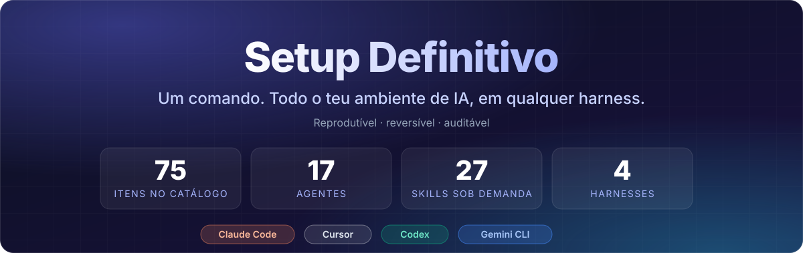
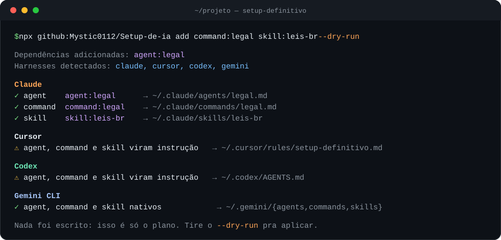
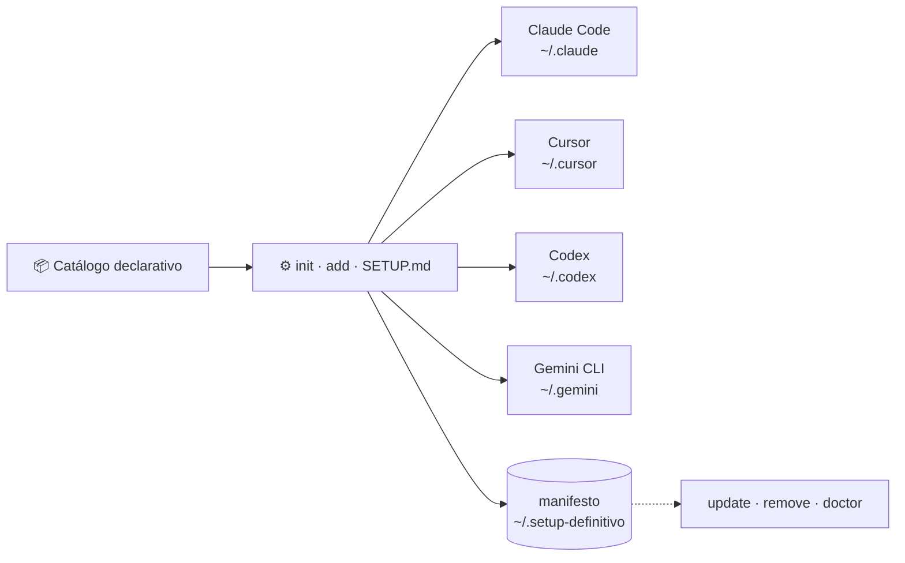

<div align="center">



<br/>


<br/>

<table>
  <tr>
    <td align="right"><b>🚀 Começar</b></td>
    <td align="center"><a href="#-início-rápido">⚡ Início rápido</a></td>
    <td align="center"><a href="#-como-funciona">🧭 Como funciona</a></td>
    <td align="center"><a href="#-harnesses">🎯 Harnesses</a></td>
  </tr>
  <tr>
    <td align="right"><b>💡 Entender</b></td>
    <td align="center"><a href="#-a-promessa">💥 A promessa</a></td>
    <td align="center"><a href="#-por-que-usar">🤔 Por que usar</a></td>
    <td align="center"><a href="#-segurança-por-design">🔒 Segurança</a></td>
  </tr>
  <tr>
    <td align="right"><b>📦 Projeto</b></td>
    <td align="center"><a href="#-catálogo">📦 Catálogo</a></td>
    <td align="center"><a href="#-pipeline-multi-harness">🔗 Pipeline</a></td>
    <td align="center"><a href="#-créditos">🙏 Créditos</a></td>
  </tr>
</table>

</div>

---

## ⚡ Início rápido

Você monta um ambiente de IA bom (agentes especializados, MCPs, skills, permissões) e quer que ele
**vá com você**: pra outra máquina, pro Cursor, pro Codex, pro Gemini, pro colega do lado. Há dois jeitos.

### Caminho A: deixe sua IA configurar

Aponte seu agente (Claude Code, Codex, Cursor, Gemini CLI, opencode…) para o repositório:

> *"Leia o SETUP.md deste repositório e configure meu ambiente."*

O [`SETUP.md`](SETUP.md) instrui o agente a detectar o ambiente, propor um plano, **esperar sua
confirmação** e aplicar, com as mesmas regras de segurança da CLI. Funciona até em harness que
ainda não tem adapter, porque quem executa é o próprio agente.

### Caminho B: use a CLI

Requer Node 20+.

```bash
# vê o plano, sem escrever nada
npx github:Mystic0112/Setup-de-ia init --dry-run

# wizard interativo
npx github:Mystic0112/Setup-de-ia init
```

Nada de publicação no npm: o `prepare` compila na instalação, então o `npx` direto do GitHub já funciona.

Quer instalar só uma coisa? Sem wizard, pelo id (dependências entram sozinhas):

<div align="center">



<sub>Saída real do <code>add --dry-run</code>, resumida. Marcar o command <code>command:legal</code> puxou o <code>agent:legal</code> junto.</sub>

</div>

---

## 💥 A promessa

| | |
|---|---|
| 📦 **Catálogo declarativo** | Agentes, commands, skills, MCPs, plugins, hooks, ferramentas e config num lugar só, fácil de estender |
| 🎯 **4 harnesses** | Claude Code, Cursor, Codex e Gemini CLI com o mesmo ambiente; onde falta recurso nativo, o conteúdo degrada pra instrução |
| 🔁 **Reprodutível** | A mesma escolha gera o mesmo ambiente, e o `update` reaplica o que está no manifesto |
| ↩️ **Reversível** | O `remove` desfaz só o que o setup instalou, e **recusa** o que você editou |
| 🔍 **Auditável** | `--dry-run` em tudo, `doctor` pra diagnosticar, catálogo em TypeScript com testes |
| 🤝 **Funciona sem CLI** | O Caminho A deixa a tua própria IA ler o `SETUP.md` e aplicar, com confirmação |

---

## 🤔 Por que usar

| Dor | Como o Setup Definitivo resolve |
|---|---|
| Troca de máquina e perde tudo | `init` e o ambiente volta, do jeito que estava |
| Cursor, Codex e Gemini guardam config em formatos diferentes | Um catálogo, um **adapter por harness** que sabe aplicar no formato dele |
| "Como você configurou isso?" vira meia hora de instrução | *"Leia o SETUP.md e configure meu ambiente."* |
| Tenta desfazer e não sabe o que era teu e o que a ferramenta criou | **Manifesto + marcadores**: o `remove` só toca no que o setup criou |
| Agente inchado, contexto caro a cada chamada | Arquitetura **od-skill**: núcleo enxuto no agente, conhecimento como skill sob demanda |
| Faltou um especialista | `agent:agent-builder` cria o agente novo no mesmo formato dos existentes |

---

## 🧭 Como funciona

O catálogo descreve **o que** instalar. Um adapter por harness sabe **como** aplicar ali.



| Comando | O que faz |
|---|---|
| `init` | Wizard interativo: harness → papéis → alvo → itens → preview → aplica |
| `add <id...>` | Instala itens pelo id, sem wizard; resolve dependências |
| `list` | Lista o catálogo inteiro por categoria |
| `doctor` | Diagnostica binários, harnesses detectados e catálogo |
| `update` | Reaplica o que está no manifesto usando o catálogo atual |
| `remove <id...>` | Desfaz o que instalou, **recusando** o que você editou |

Todos aceitam `--dry-run`. O `remove` pede confirmação (a menos de `--yes`).

---

## 📦 Catálogo

**75 itens** organizados em 8 categorias. O wizard pergunta uma categoria por vez.

<details open>
<summary><b>🧠 Agentes (17)</b> — especialistas por domínio</summary>

| id | Domínio |
|---|---|
| `agent:backend` | PHP/Laravel: APIs, refactor, debugging |
| `agent:frontend` | React/Vue/CSS, UI/UX, acessibilidade |
| `agent:database` | Modelagem, queries, tuning, migrations |
| `agent:qa` | Testes, code review, SOLID, Clean Code |
| `agent:security` | OWASP, análise de vulnerabilidades, hardening |
| `agent:devops` | Docker, CI/CD, deploy, monitoramento |
| `agent:mobile` | React Native e Flutter |
| `agent:scripting` | Python e Node: scripts, APIs, CLIs |
| `agent:typescript` | TypeScript moderno (5.x+), strict mode, tipagem avançada e contratos |
| `agent:architect` | Arquitetura de software, DDD, ADRs |
| `agent:data` | Data, BI, ETL, dashboards |
| `agent:pm` | Planejamento, estimativas, documentação |
| `agent:lead` | Coordenação multi-domínio; orquestra os demais |
| `agent:agent-builder` | **Cria outros agentes** seguindo esta mesma arquitetura |
| `agent:knowledge` | Knowledge graphs/GraphRAG, RAG, embeddings, vector search, context engineering |
| `agent:social` | Social media e conteúdo: posts, Reels, hooks, calendário, nicho, voz (spawna skills sob demanda) |
| `agent:legal` | Jurídico/LGPD: direito digital, privacidade, termos, consumidor, ancorado em fontes oficiais |

Cada agente tem um **slash command** correspondente (`command:backend` → `/backend`), que declara
dependência do agente: marcar o command puxa o agente junto.

**Arquitetura od-skill:** os agentes são **enxutos de propósito**. A definição carrega só persona,
domínio e regras, sem manual embutido. O conhecimento técnico entra **sob demanda**, como
skill de referência (`php-laravel-ref`, `owasp-laravel-ref`, `graphify`…), só quando a tarefa pede.
Menos contexto fixo por invocação = menos token e mais acurácia; conhecimento novo vira skill nova
(uma linha no catálogo) em vez de inchar o agente.

</details>

<details>
<summary><b>🔌 MCPs (2) e Plugins (4)</b></summary>

| id | O que dá |
|---|---|
| `mcp:notebooklm` 🔑 | Notebooks, fontes, geração de áudio/vídeo/slides |
| `mcp:desktop-commander` | Terminal e arquivos |
| `plugin:caveman` | Respostas compactas, sem perder substância |
| `plugin:ponytail` | Força a solução mais simples que funciona |
| `plugin:taste-skill` | Design frontend: brutalist, minimalist, redesign, stitch |
| `plugin:codex` | Delega tarefa ao Codex e traz o resultado para revisão |

Plugins vêm pelo **marketplace do harness**: nada de terceiro é redistribuído aqui.

</details>

<details>
<summary><b>📚 Skills (27)</b> — conhecimento carregado sob demanda</summary>

**Referência técnica** (os agentes carregam quando a tarefa pede):
`php-laravel-ref` · `php-code-style` · `react-ref` · `frontend-ref` · `db-engines-ref` ·
`owasp-laravel-ref` · `refs-de-ataque` · `devops-ref` · `arch-ddd-ref` · `pm-ref` · `data-bi-ref` ·
`mobile-ref` · `python-node-ref` · `api-docs-ref`

**Produtividade**:
`codex-code` · `defuddle` · `notebooklm` · `skill-builder` · `rule` · `dev-browser`

**Obsidian / grafo de conhecimento**:
`obsidian-cli` · `obsidian-markdown` · `obsidian-bases` · `json-canvas`

**Pentest**: `strix-playbooks`: 67 playbooks por vulnerabilidade, framework, cloud e
protocolo, mais rede interna, mobile, cripto, fuzzing e privesc (red team). Do
[usestrix/strix](https://github.com/usestrix/strix) (Apache-2.0) e do
[SnailSploit/claude-red](https://github.com/SnailSploit/claude-red) (MIT, adições em
`custom/`), com [atribuição](assets/playbooks/ATTRIBUTION.md). O `agent:security` depende deles.
Em cima deles, `refs-de-ataque` ensina como o pentest autônomo com IA ataca, com assinatura de
detecção no log e hardening por técnica (só defesa, sem código ofensivo).

**Jurídico/LGPD**: `leis-br` busca sob demanda qualquer norma brasileira (lei federal e estadual,
decreto, ato de agência) no acervo aberto [ctresb/leis](https://github.com/ctresb/leis) (MIT), **sem
baixar nada**: extrai só o artigo e manda confirmar no texto oficial pelo navegador antes de citar.
Usada pelo `agent:legal`. Para compliance sério, `compliance-pro-lgpd` traz workflows nível DPO,
templates PT-BR, scanner de PII e cookie checker, de
[neimaciel/compliance-pro-lgpd](https://github.com/neimaciel/compliance-pro-lgpd) (AGPL-3.0, vem por
git, não redistribuído aqui).

<details>
<summary><code>dev-browser</code>: de onde vem e um aviso importante</summary>

Vem por git de [sawyerhood/dev-browser](https://github.com/sawyerhood/dev-browser) (MIT), não de
`assets/`, assim acompanha o upstream. Depende do `tool:dev-browser`, que instala o CLI. Dirige
**só Chromium**: navegadores base Firefox (Firefox, Zen, LibreWolf) abandonaram o CDP na versão 129
e não são alcançáveis.

> **Aviso:** a SKILL.md do upstream documenta uma API à frente do pacote publicado no npm. No
> `dev-browser@0.2.9` a flag `-e` não existe, a última expressão não é impressa (precisa de
> `console.log`), o método é `page.snapshotForAI()` e não `page.snapshot()`, `page.click("ref/eN")`
> é lido como seletor CSS (use `page.getByRef("eN")`) e `page.waitForLoad()` não existe (use
> `page.waitForLoadState()`). Reportado em
> [SawyerHood/dev-browser#142](https://github.com/SawyerHood/dev-browser/issues/142): quando for
> corrigido lá, chega aqui sozinho, porque a entrada aponta para `main`.

</details>

</details>

<details>
<summary><b>🪝 Hooks (1)</b> — enforcement no harness (Claude)</summary>

`hook:rule-guard` é um hook `PreToolUse` que **bloqueia** escrita de arquivo (Write/Edit/MultiEdit)
violando regras em `~/.claude/rules.jsonl`. Stdlib pura, fail-open. Registre regras com a skill
`rule` (`/rule "proibir X em <glob>: motivo"`); a semente com regras de exemplo só é escrita se o
arquivo não existir, nunca sobrescreve as tuas. Só Claude: os adapters dos outros harnesses não aplicam `settings.json`.

</details>

<details>
<summary><b>🛠️ Ferramentas (5) e Configuração (2)</b></summary>

| id | O que faz |
|---|---|
| `tool:motion` | Motion AI Kit: skills e MCP de animação nos agentes |
| `tool:graphify` | Motor de grafo de conhecimento: código/docs → grafo consultável |
| `tool:impeccable` | Design/UX, detecção de anti-padrões de UI |
| `tool:21st` 🔑 | Roda o instalador oficial do 21st (componentes de UI) |
| `tool:dev-browser` | CLI de automação de navegador (baixa ~280 MB de Chromium) |
| `config:base-instructions` | Bloco base no CLAUDE.md / AGENTS.md / .cursorrules |
| `config:hooks-basicos` | Permissões explícitas de comandos básicos |

🔑 = precisa de credencial. Cada um tem guia em [`docs/mcp/`](docs/mcp): a CLI **nunca** pede,
lê ou grava a tua credencial.

</details>

---

## 🎯 Harnesses

| Capacidade | Claude Code | Cursor | Codex | Gemini CLI |
|---|---|---|---|---|
| Registrar MCP | ✅ `claude mcp add` | ✅ `mcp.json` | ✅ `config.toml` | ✅ `mcp_config.json` |
| Agents e commands | ✅ nativo | ⚠️ vira instrução | ⚠️ vira instrução | ✅ nativo |
| Skills | ✅ nativo | ⚠️ vira instrução | ⚠️ vira instrução | ✅ nativo |
| Plugins | ✅ marketplace | — | — | — |
| Arquivo de instrução | `CLAUDE.md` | `.cursorrules` / `rules/` | `AGENTS.md` | `GEMINI.md` |
| `settings.json` (hooks) | ✅ | — | — | — |

⚠️ = **degradação elegante**: onde o conceito não existe, o conteúdo entra como bloco marcado no
arquivo de instrução, individualmente removível.

opencode e OmniRoute aparecem no wizard marcados como *adapter não implementado*. Para eles, use o
**Caminho A** (sua IA lê o `SETUP.md`).

---

## 🔗 Pipeline multi-harness

Usa mais de uma IA? O wizard pergunta o papel de cada uma:

```
Gemini planeja  →  Codex coda  →  Claude revisa
```

A partir disso ele gera, na hora, uma **instrução de papel** em cada harness (no formato dele) e um
`HANDOFF.md` compartilhado com o protocolo de quem passa o bastão pra quem.

> **Escopo honesto:** harnesses são CLIs separadas, sem runtime compartilhado. O setup gera o
> *papel + protocolo*: cada uma sabe o que faz e como entregar. Handoff 100% automático (uma
> chamando a outra) exigiria um router; não está aqui.

---

## 🔒 Segurança por design

Mexer na config de uma ferramenta é arriscado por natureza, então o setup parte do princípio de que
**o teu arquivo vale mais que o dele**:

- **Merge, nunca overwrite.** Config nova entra por deep-merge; `CLAUDE.md`, `AGENTS.md` e afins
  recebem blocos entre marcadores (`<!-- setup-definitivo:start:<id> -->`), individualmente removíveis.
- **`remove` recusa o que você editou.** Se o arquivo mudou desde a instalação, ele para e avisa em
  vez de apagar o teu trabalho.
- **Backups fora do teu repositório.** Vão pra `~/.setup-definitivo/backups`, não pra dentro do
  projeto, pra uma credencial nunca acabar no teu git.
- **Texto de skill de terceiro não forja marcador.** Marcadores do setup dentro de conteúdo externo
  são neutralizados na hora de instalar.
- **Credencial nunca passa pela CLI.** Ela não pede, não lê e não grava; o login é sempre feito pelo
  próprio CLI da ferramenta, por você (guias em [`docs/mcp/`](docs/mcp)).
- **`--dry-run` em tudo.** Veja o plano antes de qualquer escrita.

---

## 🔄 Este repositório é vivo

**Sempre atualizado com novidades.** À medida que o ecossistema muda (MCPs novos, harnesses novos,
skills melhores, plugins que valem a pena), o catálogo acompanha.

O que está no radar:

- adapters de **opencode** e **OmniRoute**
- mais MCPs e plugins conforme aparecem
- perfis prontos (`--profile completo | design | mínimo`)
- preview por harness no wizard

Sugestões, issues e PRs são bem-vindos. Se você usa um MCP, plugin ou skill que merece entrar no
catálogo, abra uma issue: o catálogo é declarativo justamente para ser fácil de estender.

---

## 🙏 Créditos

O que não é nosso mantém a licença e a atribuição de origem:

| Item | Origem | Licença |
|---|---|---|
| `strix-playbooks` | [usestrix/strix](https://github.com/usestrix/strix) | Apache-2.0 |
| `strix-playbooks` (adições em `custom/`) | [SnailSploit/claude-red](https://github.com/SnailSploit/claude-red) | MIT |
| `dev-browser` | [sawyerhood/dev-browser](https://github.com/sawyerhood/dev-browser) | MIT |
| `compliance-pro-lgpd` | [neimaciel/compliance-pro-lgpd](https://github.com/neimaciel/compliance-pro-lgpd) | AGPL-3.0 (por git) |
| `leis-br` busca em | [ctresb/leis](https://github.com/ctresb/leis) | MIT |
| taxonomia de review do `agent:qa` | `ponytail-review`, de DietrichGebert | MIT |

Atribuição completa dos playbooks em [`assets/playbooks/ATTRIBUTION.md`](assets/playbooks/ATTRIBUTION.md).

---

<div align="center">

**MIT** · feito para quem cansou de reconfigurar o ambiente do zero

</div>
